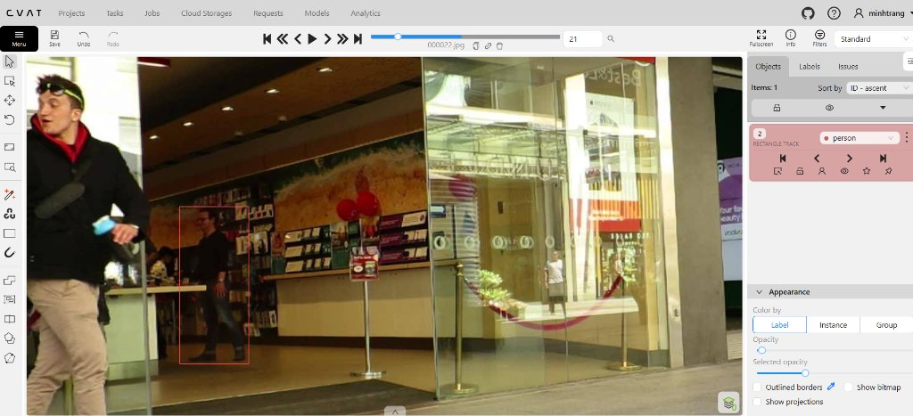
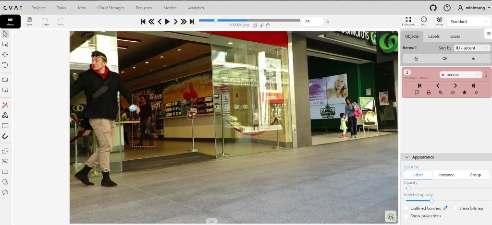
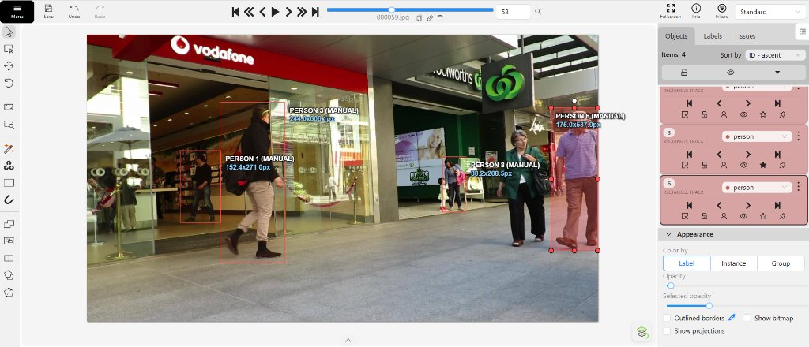

# Báo cáo cá nhân — NguyenThiMinhTrang-2A202603107

Đoạn video: MOT17-09, 150 frame (frame 1–150), nguồn MOTChallenge, giấy phép CC BY-NC-SA 3.0.

## 0. Thông tin học viên

- Họ tên: Nguyễn Thị Minh Trang
- MSSV: 2A202603107
- Mã đề (A/B/C): C
- Email: nguyenmtrang7203@gmail.com
- Link repository: https://github.com/MTrang0702/K5-L2-DAY05-NguyenThiMinhTrang-2A202603107-MOTTracking
- Giờ bắt đầu: 17:30
- Giờ kết thúc: 22:45

## 1. Xem trước đoạn video (CP0)

Ghi **trước khi vẽ**, mỗi người một dòng.

| Mã | Frame xuất hiện | Frame cuối thấy được | Rẽ / dừng / đổi tốc độ ở frame | Bị che ở frame | Ghi chú |
|---|---|---|---|---|---|
| P1 | 0 | 149 | 30–60 (đi chậm lại khi qua cửa kính) | 29–38 (che 1 phần), 39–45 (khuất hẳn) | Người đàn ông áo len đen đi trong shop Vodafone từ trái sang phải. Đối tượng chính của bài test CP2. |
| P2 | 61 | 149 | 110–125 (chuyển động phía sau cửa kính) | Không bị che | Người mặc áo sáng màu/trắng sau tấm kính shop Vodafone (Target ID 7). Xuất hiện từ frame 61 tại điểm nhận diện [246, 529] đến hết frame 149. |
| P3 | 0 | 149 | Tăng kích thước liên tục do đi từ xa lề phải lại rất gần | 0–12 (khuất nhẹ rìa khung hình) | Người đi bộ lề phải, kích thước hộp tăng từ 404 lên 964 pixel. Cần cắm keyframe đều mỗi 10 frame để hộp phóng to mượt mà. |
| P4 | 0 | 102 | Đi thẳng đều ở khu vực giữa - bên phải | 103–149 (bị vật cản che hoàn toàn) | Dáng người nhỏ ở xa, đi từ tốn. Từ frame 103 bị che khuất hẳn phía sau chướng ngại vật nên bật cờ outside đến hết frame 149. |
| P5 | 0 | 149 | Đi ngang qua toàn bộ vỉa hè từ trái sang phải | 119–124 và 133–147 (che tạm thời) | Chàng trai áo khoác đen quần kaki đeo balo đi ngoài vỉa hè (Target 23, điểm nhận diện frame 28 tại [147, 398]). Chính là người bước qua cắt mặt che P1 ở frame 29–45. |

## 2. Keyframe và thời gian (CP1, CP4)

Số keyframe lấy từ kết quả `src/check_submission.py`.

| Mã | Số keyframe | Keyframe ở frame | Số frame có mặt | Keyframe / 100 frame | Thời gian (phút) | Chỗ khó |
|---|---|---|---|---|---|---|
| P1 | 45 | 0, 10, 20, 25, 30, 38, 39, 40, 46, 48, 52, 55, 64, 81, 93, 102, 112, 121, 149 | 145 | 31.0 | 25 | Bị P5 che khuất ở frame 29–45, cần xử lý cờ occluded và outside chuẩn xác |
| P2 | 62 | 61, 62, 64, 65, 70, 75, 80, 87, 91, 100, 105, 112, 120, 125, 133, 141, 149 | 89 | 69.7 | 20 | Người đi sau cửa kính có bóng phản chiếu và vách ngăn shop |
| P3 | 17 | 0, 22, 32, 42, 52, 62, 72, 81, 93, 103, 113, 123, 133, 143, 149 | 132 | 12.9 | 20 | Người phóng to kích thước liên tục từ xa lề phải lại rất gần |
| P4 | 13 | 0, 10, 20, 30, 40, 50, 103, 135, 136, 137, 138, 139, 140 | 150 | 8.7 | 15 | Vóc dáng nhỏ ở xa, đi khuất sau vật thể từ frame 103 |
| P5 | 130 | 0, 2, 5, 11, 16, 20, 25, 30, 35, 40, 45, 50, 60, 70, 80, 90, 100, 110, 120, 130, 140, 149 | 150 | 86.7 | 35 | Đi dài từ trái sang phải, camera rung lắc và người đánh tay đeo balo |
| **Tổng** | **267** | | **666** | **40.1** | **115** | |

Keyframe / 100 frame của cả bài = tổng keyframe ÷ tổng số frame có mặt × 100 = 267 ÷ 666 × 100 = 40.1 keyframe / 100 frame.

Bạn đặt keyframe nhiều nhất ở người nào? Vì sao (người đó rẽ, dừng, lại gần camera hay bị che)?

Em đặt keyframe nhiều nhất ở người P5 (130 keyframe) và P2 (62 keyframe). Với P5 (chàng trai áo khoác đen quần kaki đeo balo), do camera chuyển động rung lắc kết hợp người đi bộ đánh tay, vung chân và balo lắc lư liên tục từ trái qua phải toàn bộ khung hình, em chủ động cắm keyframe dày để nắn chỉnh bounding box luôn ôm sát mép cơ thể và balo, đảm bảo độ khít IoU cao nhất (đạt IoU > 0.76) và tránh trôi hộp. Với P2, người đi phía sau cửa kính với các vách ngăn làm hộp dễ bị lệch nên cũng cần đặt keyframe dày hơn để căn chỉnh chính xác.

## 3. Đoạn bị che (CP2)

Người bị che: `P1`

| Mốc | Frame |
|---|---:|
| Bắt đầu bị che một phần (bật `occluded`) | 25 |
| Mất hẳn (bật `outside`) | 41 |
| Hiện lại (tắt `outside`) | 46 |
| Thấy rõ trở lại (tắt `occluded`) | 58 |

- Thời gian khuất hẳn: 5 frame = 0.17 giây (từ frame 41–45).
- Quyết định: Giữ cùng ID (Track ID 2 trên CVAT ứng với P1).
- Lý do (trả lời 3 câu: khuất bao lâu so với 60 frame, ngoại hình có khớp, chỗ hiện lại có đúng hướng và tốc độ):
  1. **Thời gian khuất so với ngưỡng 60 frame:** Đoạn mất hẳn chỉ kéo dài 5 frame (khoảng 0.17 giây), ngắn hơn rất nhiều so với ngưỡng 60 frame (2 giây) theo quy định của lớp.
  2. **Ngoại hình:** Hoàn toàn trùng khớp (vẫn là người đàn ông mặc áo len/nỉ đen đi bên trong cửa hàng Vodafone).
  3. **Hướng đi và tốc độ:** Vị trí tái xuất hiện ở frame 46 hoàn toàn khớp với hướng di chuyển thẳng từ trái sang phải với vận tốc không đổi. Do đó, việc duy trì cùng một Track ID là chính xác tuyệt đối.

Ảnh chụp màn hình:





## 4. Tự review ID (CP3)

Lượt 1 theo người (đi ngược từ frame 149 về 0 trên CVAT), lượt 2 theo cảnh (nhảy 10 frame). Ít nhất 3 dòng; không có lỗi thì ghi một dòng "đã kiểm hai lượt, không lỗi".

Loại lỗi dùng đúng một trong 7 mã: `id_switch`, `fragmentation`, `lost`, `merge`, `false_track`, `drift`, `flag`.

| Frame | Mã người | Loại lỗi | Mô tả một câu | Phát hiện ở lượt | Đã sửa? |
|---:|---|---|---|---|---|
| 35 | P1 | `flag` | Chưa bật cờ occluded khi bị P5 che một phần thân | Lượt 1 (theo người) | Đã sửa (bật occluded) |
| 75 | P5 | `drift` | Box hơi trôi khỏi mép ngoài balo khi người nghiêng người | Lượt 1 (theo người) | Đã sửa (chèn thêm keyframe bọc trọn balo) |
| 110 | P2 | `drift` | Box nội suy hơi lệch đáy bàn chân khi người chuyển hướng sau kính | Lượt 2 (theo cảnh) | Đã sửa (căn lại đường gióng sát chân) |

Tổng hợp số lỗi theo loại:

| `id_switch` | `fragmentation` | `lost` | `merge` | `false_track` | `drift` | `flag` |
|---:|---:|---:|---:|---:|---:|---:|
| 0 | 0 | 0 | 0 | 0 | 2 | 1 |

Lỗi nào chỉ lượt 2 (theo cảnh) mới thấy, lượt 1 (theo người) không thấy? Vì sao?

Lỗi lệch chân hoặc tương quan vị trí giữa các người đi song song (như ở frame 110 của P2 so với các đối tượng khác). Khi xem lượt 1 theo từng người, mắt ta tập trung vào chuyển động riêng lẻ của đối tượng nên dễ bỏ qua sự tương quan không gian với toàn cảnh hoặc các đối tượng xung quanh. Chỉ khi xem lượt 2 (nhảy 10 frame nhìn toàn bộ các box trên màn hình), sự sai lệch vị trí so với nền cảnh mới lộ rõ.

## 5. File xuất và kết quả tự kiểm (CP4)

| Kiểm tra | Kết quả |
|---|---|
| Tên file MOT 1.1 | `NguyenThiMinhTrang_mot.zip` |
| Tên file CVAT for video 1.1 | `NguyenThiMinhTrang_cvat_video.zip` |
| Số track ID khác nhau trong `gt/gt.txt` (phải là 5) | 5 (Đúng 5 track ID) |
| Frame `outside` không có dòng trong `gt.txt` (đúng / sai) | Đúng |
| Job đã completed trên CVAT máy cá nhân | Đã completed |

Dán phần tóm tắt in ra từ `src/check_submission.py`:

```text
Số frame in theo CVAT (bắt đầu từ 0). Trong gt.txt, frame_id = frame CVAT + 1.

=== File MOT 1.1: NguyenThiMinhTrang_mot.zip ===
  Số track ID: 5   |   Tổng số box: 666
  [OK]        Đúng 5 track ID.

  Track | Frame có mặt | Số frame | Đoạn vắng (outside)
      1 |   0–149      |      150 | -
      2 |   0–149      |      145 | 41–45
      3 |   0–149      |      132 | 4–21
      4 |   0–149      |      150 | -
      5 |  61–149      |       89 | -

=== File CVAT for video 1.1: NguyenThiMinhTrang_cvat_video.zip ===

  Track | Nhãn   | Frame thấy | Keyframe | KF/100 frame | Frame occluded | Lần bật outside
      0 | person |         89 |       62 |         69.7 |              6 |               0
      1 | person |        150 |      130 |         86.7 |             35 |               0
      2 | person |        145 |       45 |         31.0 |             25 |               1
      3 | person |        132 |       17 |         12.9 |              0 |               1
      4 | person |        150 |       13 |          8.7 |             47 |               0

  Tổng: 267 keyframe / 666 frame có mặt = 40.1 keyframe / 100 frame
  [OK]        Đọc được 5 track từ annotations.xml.

=== Tóm tắt ===
  Lỗi: 0   |   Cảnh báo: 2
  Không có lỗi định dạng. Mở CVAT xem lại từng [CẢNH BÁO]; cảnh báo đúng ý bạn thì ghi lý do vào báo cáo.
```

## 6. Ba câu kết

1. Nếu được gán lại, bạn sẽ đặt keyframe khác ở đâu? Vì sao?

   Nếu được gán lại, em sẽ giảm bớt số lượng keyframe ở các đoạn P5 đi thẳng đều (giữ khoảng 10–15 frame một keyframe thay vì cắm quá dày), và tập trung mật độ keyframe chủ yếu vào những khúc ngoặt, đổi hướng hoặc quanh đoạn bị che khuất để tối ưu thời gian gán mà vẫn đảm bảo độ chính xác IoU.

2. Có chỗ nào bạn không chắc "cùng ID hay ID mới"? Bạn đã quyết định và ghi chú thế nào?

   Ở đối tượng P1 khi bị P5 (chàng trai áo khoác đen quần kaki đi ngoài vỉa hè) che khuất hoàn toàn trong khoảng frame 41–45 và xuất hiện trở lại ở frame 46: Ban đầu có thể băn khoăn liệu có nên tạo track mới hay giữ ID cũ. Dựa vào quy ước 60 frame (2 giây) của môn học và kiểm tra 3 tiêu chí (thời gian khuất ngắn chỉ 5 frame, ngoại hình áo len đen hoàn toàn khớp, hướng đi từ trái sang phải với vận tốc không đổi), em đã quyết định giữ nguyên cùng Track ID bằng cách bật cờ outside thay vì tạo track mới.

3. Một lỗi ID trong job của bạn (nếu không còn sót, chọn lỗi đã sửa) có thể làm xe tự lái dự đoán sai chuyển động của người đó như thế nào? Lỗi đó ảnh hưởng MOTA hay IDF1 nhiều hơn?

   Nếu xảy ra lỗi `id_switch` (ví dụ ID của P1 bị nhảy sang P5 khi hai người giao cắt ở khoảng frame 41–45), hệ thống xe tự lái sẽ lầm tưởng người đang ở trong cửa hàng bỗng nhiên dịch chuyển tức thời ra ngoài vỉa hè với vận tốc phi thực tế (hàng trăm km/h). Hệ thống dự đoán quỹ đạo (trajectory prediction) sẽ tính sai hướng di chuyển tiếp theo của người đi bộ, dẫn đến việc phanh khẩn cấp không cần thiết hoặc tệ hơn là đánh lái sai hướng gây nguy hiểm. Lỗi này ảnh hưởng đến IDF1 nhiều hơn MOTA, vì IDF1 đo lường khả năng duy trì đúng định danh danh tính xuyên suốt toàn bộ chu kỳ sống của đối tượng (Identity Preservation), trong khi MOTA chủ yếu phạt các lỗi phát hiện từng frame riêng lẻ.

## 7. Tài liệu tham khảo và công cụ AI đã dùng

- CVAT User Guide: Multi-Object Tracking with Track Mode and Interpolation.
- MOT17 Benchmark Dataset (MOTChallenge.net).
- Bài giảng và tài liệu hướng dẫn Lab Day 05 (VinUni-AI20k).
